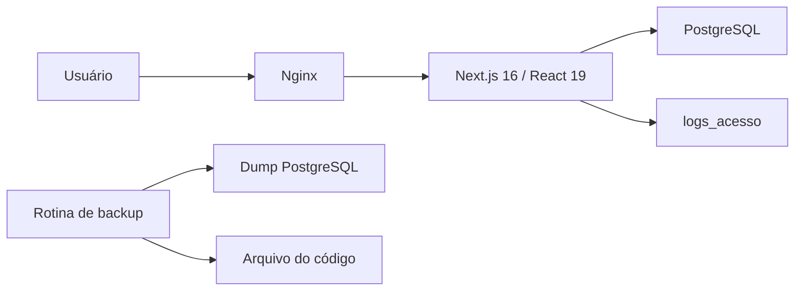

# Documentação operacional do escolaDB

**Versão:** ciclo de prioridades 1 a 17  
**Ambiente de referência:** VPS de produção com Docker  
**Atualização:** 14 de setembro de 2026

## Finalidade

O escolaDB administra escolas, usuários, turmas, matrículas anuais, disciplinas, vínculos de professores, notas, avaliações, recuperações, auditoria, indicadores e relatórios. O sistema mantém a interface atual e aplica autorização no servidor para todos os dados escolares.

## Arquitetura



- Frontend e backend: Next.js App Router, React e TypeScript.
- Banco: PostgreSQL acessado pela biblioteca `postgres`.
- Autenticação: JWT em cookie `httpOnly`, assinatura HS256 e expiração de 8 horas ou 30 dias quando “lembrar acesso” é escolhido.
- Infraestrutura: contêineres `escola-app`, `escola-db` e proxy Nginx.
- Estilo: Tailwind CSS 4 e tokens de tema em `src/app/globals.css`.
- Testes: executor nativo do Node por meio de `tsx --test`.

## Controle de acesso

| Papel | Escopo | Notas e avaliações | Relatórios | Usuários | Auditoria | Ferramentas internas |
|---|---|---:|---:|---:|---:|---:|
| Dev Master | Todas as escolas | Sim | Sim | Sim | Sim | Sim |
| Administrador Multi-Escolas | Todas as escolas | Sim | Sim | Sim | Sim | Não |
| Direção/Coordenação | Própria escola | Sim | Sim | Sim, na própria escola | Não | Não |
| Professor | Turmas e disciplinas vinculadas | Sim | Sim, no próprio escopo | Não | Não | Não |
| Somente leitura | Própria escola | Não | Sim | Não | Não | Não |

A matriz central fica em `src/types/roles.ts`. APIs também verificam escola, turma e disciplina; esconder um menu não é usado como mecanismo de segurança.

## Sessões e senhas

Cada usuário possui `session_version`. O número é incluído no JWT e comparado com o banco em toda validação:

- logout revoga o token atual por `jti`;
- redefinição administrativa de senha incrementa `session_version`, exige troca no próximo acesso e invalida todas as sessões anteriores;
- desativação de usuário incrementa a versão e invalida todas as sessões;
- usuário inativo é rejeitado mesmo que ainda tenha um JWT assinado;
- troca feita pelo próprio usuário incrementa a versão e emite uma sessão nova;
- senha e hash nunca são gravados nos logs de auditoria.

## Telas

| Tela | Objetivo e dados | Alterações permitidas | Fonte | Permissão |
|---|---|---|---|---|
| `/login` | Entrada no sistema | Inicia sessão | `usuarios`, `tentativas_login` | Pública |
| `/trocar-senha` | Troca obrigatória ou voluntária | Senha do próprio usuário | `usuarios` | Autenticado |
| `/dashboard` | Lista e visão geral das escolas | Nenhuma | `escolas` | Perfis globais |
| `/dashboard/escolas/[id]` | Indicadores, turmas, alertas e gráficos | Filtros | Alunos, matrículas, notas, turmas, disciplinas | Escopo da escola/turma |
| `/analytics` | Análise anual e por bimestre | Filtros | Notas, matriz e cadastros | Escopo autorizado |
| `/dashboard/aluno/[id]` | Histórico individual e tendência | Nenhuma | Notas, aluno, turma e disciplina | Escopo autorizado |
| `/dashboard/diario` | Diário por turma e disciplina | Lançamento em lote de notas | Matrículas, matriz e notas | Quem gerencia notas |
| `/dashboard/avaliacoes` | Avaliações, resultados e recuperação | Criação, resultados e recuperação | Avaliações, resultados, recuperações e notas | Quem gerencia notas |
| `/dashboard/relatorios` | Seis relatórios, filtros, CSV e impressão/PDF | Exportação | Notas, matrículas, recuperações e cadastros | `viewReports` |
| `/dashboard/usuarios` | Usuários e estados | Criar, redefinir senha, ativar/desativar | `usuarios` | `manageUsuarios` |
| `/dashboard/vinculos-professores` | Escopo docente | Criar/desativar vínculo | `professor_vinculos` | `manageUsuarios` |
| `/dashboard/logs` | Auditoria com antes/depois | Filtros | `logs_acesso` | Dev Master e Super Admin |
| `/dashboard/ajustar-notas` | Correção excepcional | Ajuste auditado | `notas` | Dev Master ou conta nominal autorizada |

## APIs principais

- `/api/auth/login`, `/logout`, `/me` e `/trocar-senha`: ciclo de sessão.
- `/api/usuarios` e `/api/usuarios/[id]`: cadastro e estado de usuários.
- `/api/usuarios/[id]/resetar-senha`: redefinição e revogação global.
- `/api/diario` e `/api/notas`: contexto autorizado e lançamento atômico.
- `/api/avaliacoes` e `/api/recuperacoes`: avaliação detalhada, média ponderada e recuperação.
- `/api/relatorios`: opções, filtros, dados agregados e CSV.
- `/api/logs`: auditoria com ocultação recursiva de campos sensíveis.
- `/api/dashboard/*`: KPIs, ranking, distribuição, tendência, heatmap e comparativos.
- `/api/professor-vinculos`: administração do escopo docente.
- `/api/dev/ajuste-notas`: correção excepcional restrita.

## Modelo de dados

| Tabela | Responsabilidade | Relações centrais |
|---|---|---|
| `escolas` | Unidade escolar e período atual | Origem do escopo |
| `usuarios` | Conta, papel, escola, estado e versão de sessão | Escola e auditoria |
| `turmas` | Série, etapa e grupo pedagógico | Escola, alunos e matrículas |
| `alunos` | Identidade escolar e estado legado sincronizado | Escola e turma atual |
| `matriculas` | Situação anual, chamada e período | Aluno, turma, escola e ano |
| `disciplinas` | Cadastro escolar de componentes | Escola e matriz |
| `matriz_disciplinas` | Disciplina válida por etapa | Disciplina e escola |
| `professor_vinculos` | Turmas e disciplinas autorizadas | Usuário, escola, turma e disciplina |
| `notas` | Nota oficial por matrícula, disciplina e bimestre | Matrícula, aluno, turma e disciplina |
| `avaliacoes` | Instrumento, peso e nota máxima | Turma, disciplina e período |
| `resultados_avaliacoes` | Resultado individual ou ausência | Avaliação e matrícula |
| `recuperacoes` | Nota anterior, recuperação, critério e final | Matrícula e disciplina |
| `logs_acesso` | Quem, quando, objeto, antes/depois e sucesso | Usuário e escola |
| `tokens_revogados` | Revogação de uma sessão por `jti` | JWT |
| `tentativas_login` | Limite de tentativas e ações sensíveis | E-mail e IP |

## Regras de notas

- Escala oficial de 0 a 10, validada no frontend, backend e banco.
- Uma nota oficial por matrícula, disciplina, ano e bimestre.
- Lotes são validados integralmente e gravados em uma transação.
- Média de avaliações normaliza notas máximas diferentes e aplica os pesos.
- Recuperação preserva a nota anterior e admite `MAIOR_NOTA`, `MEDIA_ARITMETICA` ou `SUBSTITUICAO`.
- Alterações críticas e auditoria são gravadas na mesma transação.
- `origem_calculo` informa lançamento manual, avaliações ou recuperação.

## Relatórios

A tela de relatórios oferece:

1. turma: média, extremos, notas abaixo de 5 e recuperações por aluno;
2. disciplina: comparação de desempenho;
3. aluno: histórico por disciplina e bimestre;
4. recuperação: antes, recuperação, final e diferença;
5. evolução: notas do 1º ao 4º bimestre;
6. risco: contagens objetivas de notas baixas, disciplinas abaixo da média e quedas.

Filtros: escola, ano, bimestre, turma, disciplina, aluno e situação da matrícula. O CSV contém os mesmos filtros e neutraliza células iniciadas por `=`, `+`, `-` ou `@`. A impressão do navegador gera papel ou PDF com o mesmo recorte.

O índice composto é experimental: 50% média normalizada, 30% percentual de notas maiores ou iguais a 5 e 20% evolução. Ele informa tamanho da amostra e pares comparáveis; não define aprovação e não diagnostica alunos.

## Transferências e disciplinas

A matrícula anual é a fonte do estado letivo. Um gatilho sincroniza `alunos.status` e `alunos.ativo` quando a matrícula muda. Uma disciplina duplicada sem referências foi preservada como inativa, e um índice impede nomes normalizados repetidos entre disciplinas ativas da mesma escola.

## Auditoria

`logs_acesso` registra usuário, papel, escola, ação, tabela, registro, tela, IP, agente, sucesso e JSON anterior/novo. A API remove recursivamente chaves com senha, hash, token ou segredo. Exportações também são auditadas.

## Operação diária

- Confirmar `docker ps` e os contêineres `escola-app` e `escola-db`.
- Conferir erros recentes com `docker logs --since 15m escola-app`.
- Validar o login e uma rota autenticada após implantação.
- Rodar `npm test`, `npm run lint` e `npx tsc --noEmit` antes do build.
- Aplicar migrações primeiro em restauração isolada e duas vezes para confirmar idempotência.
- Não criar avaliações ou recuperações fictícias em produção.

## Backup e restauração

### Rotina automática diária

O backup integral do PostgreSQL é executado diariamente às **02h15 UTC**, equivalente a **23h15 no horário de Brasília**. O agendamento ativo do usuário de operação é:

```text
15 2 * * * /home/sombra/bin/escola-backup.sh
```

Arquivos e destinos:

- script ativo: `/home/sombra/bin/escola-backup.sh`;
- cópia versionável do script: `scripts/backup-drive.sh`;
- cópias locais: `/home/sombra/backups/escola`;
- log: `/home/sombra/backups/escola/backup.log`;
- destino remoto: `gdrive:Sistema Escolar/Backups PostgreSQL`;
- configuração OAuth do rclone: `/home/sombra/.config/rclone/rclone.conf`, com permissão `600`;
- retenção local: 7 dias;
- retenção remota: 30 dias.

O dump usa o formato custom do PostgreSQL, compressão nível 9, sem proprietário e sem privilégios específicos. Cada execução valida o catálogo com `pg_restore --list` e grava um arquivo `.sha256`. Um bloqueio com `flock` impede duas execuções simultâneas.

Se o remoto `gdrive:` estiver indisponível, a cópia local permanece salva e o log recebe um aviso. A conexão pode ser conferida sem exibir credenciais com:

```bash
rclone lsd "gdrive:Sistema Escolar/Backups PostgreSQL"
```

Verificações operacionais recomendadas:

```bash
tail -n 50 /home/sombra/backups/escola/backup.log
ls -lh /home/sombra/backups/escola/escola_*.dump
rclone lsl "gdrive:Sistema Escolar/Backups PostgreSQL"
sha256sum -c /caminho/do/arquivo.dump.sha256
docker exec -i escola-db pg_restore --list < /caminho/do/arquivo.dump
```

### Teste de restauração

Nunca restaurar diretamente sobre o banco de produção como teste. Procedimento seguro:

1. baixar o `.dump` e o `.sha256` correspondentes;
2. validar o checksum;
3. criar um banco temporário com nome exclusivo;
4. restaurar o dump com `pg_restore`;
5. conferir tabelas, restrições e totais de registros;
6. validar login, alunos, matrículas, notas e relatórios usando o banco isolado;
7. remover o banco temporário somente depois de registrar o resultado.

Exemplo técnico:

```bash
docker exec escola-db createdb -U admin escola_restore_teste
docker exec -i escola-db pg_restore -U admin -d escola_restore_teste --clean --if-exists < /caminho/do/arquivo.dump
```

Para restaurar o banco oficial, interromper a aplicação, gerar um backup imediatamente anterior à restauração e avaliar o impacto dos registros criados depois do ponto recuperado.

### Pacotes antes e depois de grandes implantações

A rotina deve gerar:

- `codigo-antes.tar.gz` e `codigo-depois.tar.gz`, excluindo `.env`, `.git`, `.next` e `node_modules`;
- `banco-antes.dump` e `banco-depois.dump` no formato custom do PostgreSQL;
- estado e diff do Git;
- logs de testes, migração, smoke test e integridade;
- `SHA256SUMS-FINAL`.

Procedimento de teste:

1. criar um banco temporário com nome exclusivo;
2. restaurar o dump com `pg_restore --clean --if-exists`;
3. comparar totais e restrições essenciais;
4. aplicar a migração duas vezes;
5. executar uma transação funcional e revertê-la;
6. remover o banco temporário;
7. copiar o pacote completo para armazenamento fora da VPS;
8. validar os checksums novamente no destino.

Não armazenar arquivos `.env` nos pacotes.

## Implantação e reversão

1. gerar tag da imagem atual no formato `docker-site-escola:pre-<rodada>`;
2. construir uma imagem candidata;
3. executar testes dentro da imagem;
4. aplicar a migração validada;
5. instalar os arquivos no repositório;
6. atualizar o serviço `site-escola`;
7. executar smoke tests autenticados;
8. gerar artefatos “depois”.

Para reverter a aplicação, usar a imagem `pre-<rodada>`. Migrações deste ciclo são aditivas; a reversão de dados deve usar o dump correspondente, após avaliar o impacto de registros criados depois da implantação.

## Limitações conhecidas

- Não existe tabela nem fluxo de frequência; portanto o sistema não pode calcular presença ou cruzar frequência com rendimento sem um módulo futuro.
- O índice composto ainda precisa de observação por mais períodos antes de qualquer uso institucional.
- Não há usuários com papel Professor nem vínculos docentes cadastrados no conjunto atual.
- A convenção `middleware.ts` está depreciada no Next.js 16 e deve migrar para `proxy.ts`.
- Dependências precisam de uma rodada própria de atualização e regressão conforme os alertas do `npm audit`.
